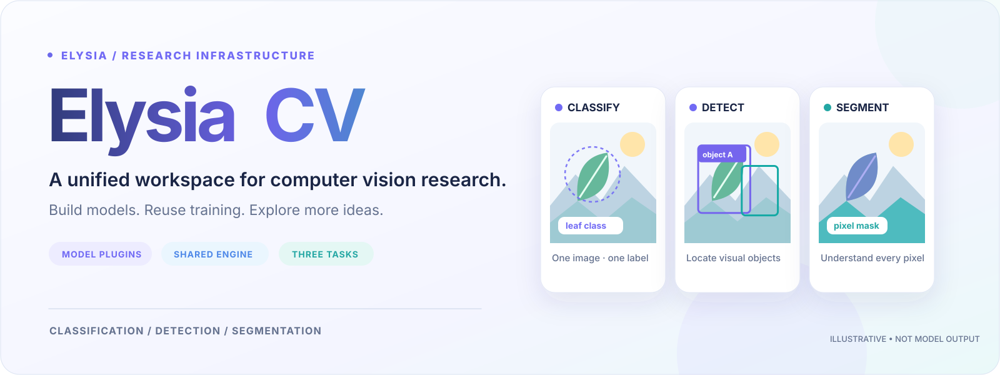
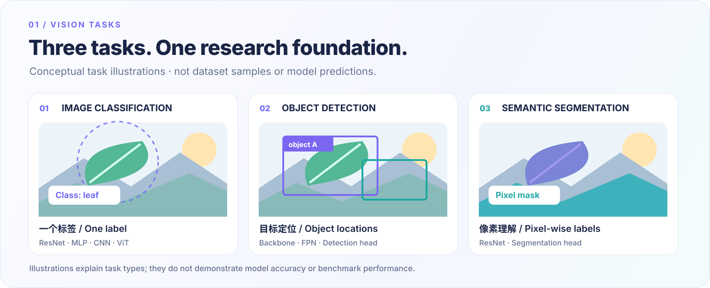
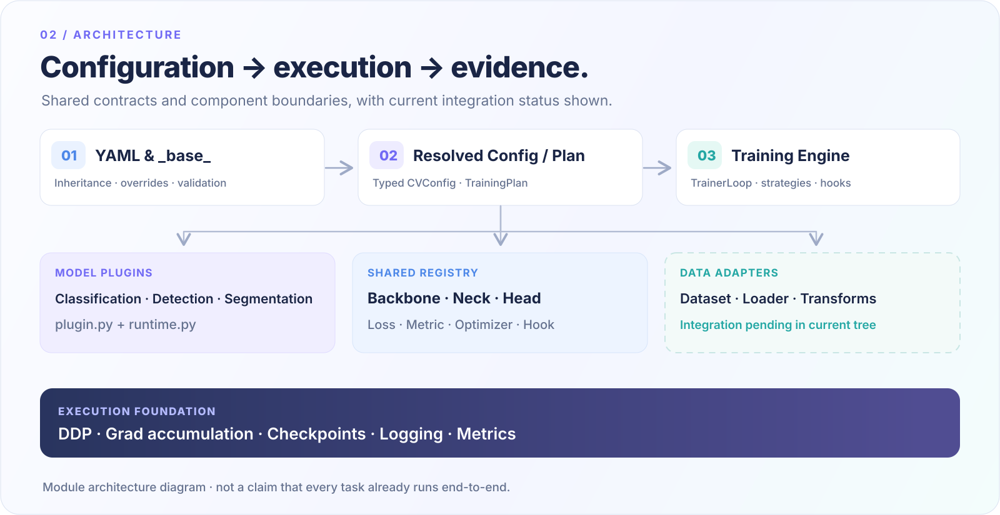
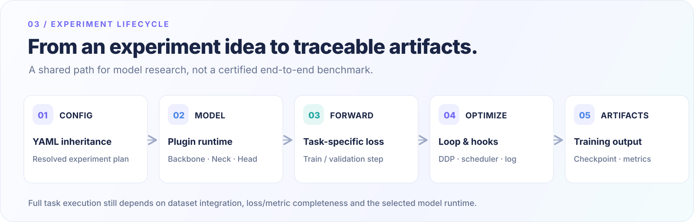

<a id="top"></a>

<div align="center">
  <picture>
    <source media="(max-width: 650px)" srcset="docs/assets/readme/hero-mobile.svg" />
    
  </picture>

  <h3>让视觉研究聚焦模型，让工程基础设施持续复用。</h3>
  <p>面向 Classification、Detection 与 Segmentation 的模块化研究框架，统一配置、模型插件、共享组件与训练生命周期。</p>

  <p>
    <a href="pyproject.toml"></a>
    <a href="pyproject.toml"></a>
    <a href="docs/status/current.md"></a>
    <a href="LICENSE"></a>
  </p>

  <p>
    <a href="#overview">项目概览</a> ·
    <a href="#vision-tasks">视觉任务</a> ·
    <a href="#architecture">系统架构</a> ·
    <a href="#quick-start">快速开始</a> ·
    <a href="#models">模型与组件</a> ·
    <a href="#roadmap">开发路线</a> ·
    <a href="#docs">文档导航</a>
  </p>
</div>

---

<a id="overview"></a>
## One foundation. Many vision experiments.

**ElysiaCV 是面向计算机视觉研究的长期工程基础设施，而不是单一模型的训练脚本合集。** 它希望让不同的视觉任务共享清晰的配置合同、可复用的组件和统一的训练机制；模型自身的结构、损失函数和任务语义则由各自的插件实现。

项目借鉴了 [ElysiaRobot](https://github.com/invoidstar/ElysiaRobot) 的模块化与训练工程经验，但 ElysiaCV 关注的是通用计算机视觉任务，而非 VLA 的动作预测与仿真环境。

<table>
  <tr>
    <td width="33%" valign="top">
      <h3>01 · 插件式模型</h3>
      <p>模型以独立目录管理，通过 <code>plugin.py</code> 声明身份，使用 <code>runtime.py</code> 封装任务逻辑。</p>
    </td>
    <td width="33%" valign="top">
      <h3>02 · 可组装组件</h3>
      <p>共享 Backbone、Neck、Head、Loss 和 Metric，减少实验之间的重复实现。</p>
    </td>
    <td width="33%" valign="top">
      <h3>03 · 配置驱动</h3>
      <p>YAML、<code>_base_</code> 继承、环境变量与命令行覆盖，帮助维护可追溯的实验配置。</p>
    </td>
  </tr>
  <tr>
    <td valign="top">
      <h3>04 · 统一训练内核</h3>
      <p>复用训练循环、优化器、调度器、梯度累积、分布式策略与 Hook 回调机制。</p>
    </td>
    <td valign="top">
      <h3>05 · 实验生命周期</h3>
      <p>围绕 CVConfig、日志、Checkpoint 和指标收集组织运行过程。支持 <code>--resume</code> 断点续训。</p>
    </td>
    <td valign="top">
      <h3>06 · 开发者体验</h3>
      <p>MessageHub 状态总线、EMA 日志平滑、DataPrefetcher 异步预取、<code>elysia config dump</code> 完整配置展开。</p>
    </td>
  </tr>
</table>

> **当前阶段：v0.2.0 · Alpha / 工程原型。** 分类、检测 (FCOS-style)、语义分割（FCN）三类任务均已完成真实端到端训练闭环，包含真损失函数、COCO 标准 mAP 指标、COCO 数据集加载和 `data/` 变换管线。详细的模块完成状态见 [当前工程状态](docs/status/current.md)。

<a id="vision-tasks"></a>
## Vision tasks · 从图像理解到像素级预测



| 任务 | 研究目标 | 当前示例 |
| --- | --- | --- |
| **Image Classification** | 将输入图像映射为类别，用于分类基线与模型架构对比。 | ResNet 系列；Cassava 的 MLP、SimpleCNN、ResNet、ViT 配置与 Runtime。 |
| **Object Detection** | FCOS-style anchor-free 单阶段检测，多尺度 FPN 特征 + center-sampling。 | ResNet-50/101 + FPN + DetHead，支持 COCO 数据加载、真损失、NMS 和 COCO mAP。 |
| **Semantic Segmentation** | 为图像中的像素预测语义类别。 | ResNet-50/101 + SegHead，CE / Dice 损失，MeanIoU 指标。 |

三条任务共用研究基础设施，**模型实现、数据接入、真损失和标准评测指标均已完成端到端闭环**。上方配图是原创概念图，不代表实验结果。

<a id="architecture"></a>
## Architecture · 清晰的核心合同与插件边界

<picture>
  <source media="(max-width: 650px)" srcset="docs/assets/readme/architecture-mobile.svg" />
  
</picture>

| 层级 | 职责 | 主要位置 |
| --- | --- | --- |
| **Config & Plan** | 配置继承、类型化解析、运行参数编译与校验。 | [`config/`](src/elysia_cv/config/) · [`training/plan.py`](src/elysia_cv/training/plan.py) |
| **Model Plugins** | 声明模型规格，构建模型并定义专属训练 / 测试前向。 | [`models/`](src/elysia_cv/models/) |
| **Component Registry** | 注册与组装可复用模型零件、损失函数和评测指标。 | [`core/registry.py`](src/elysia_cv/core/registry.py) · [`components/`](src/elysia_cv/components/) |
| **Training Engine** | 组织训练循环、分布式执行（DDP/FSDP）、调度、Hook 与 Checkpoint。 | [`training/`](src/elysia_cv/training/) |
| **Data Pipeline** | COCO/ImageFolder 数据集、变换管线 (Compose)、采样器和异步预取。 | [`data/`](src/elysia_cv/data/) |

**模型插件**负责"如何构建模型、如何定义任务 Loss"；**共享引擎**负责"何时迭代、何时更新权重、何时记录或保存"。更详细的设计见 [架构合同](docs/infrastructure/architecture.md)。

<a id="lifecycle"></a>
## Experiment lifecycle · 一条可复用的实验主路径



配置与模型规范进入训练计划，Task Runtime 负责前向及 Loss，训练循环管理更新策略，Hook 负责日志、评估与 Checkpoint。ElysiaCV 将这几项职责分开，是为了允许模型替换，而不需要重写外围工程。

现有训练实现包含梯度累积、DDP·FSDP 同步策略、MetricsRuntime 与多种 Hook（Logger/Checkpoint/Eval/LrScheduler）；它们是**可复用的工程模块**。详见 [性能指南](docs/infrastructure/performance.md)。

<a id="quick-start"></a>
## Quick start · 从仓库和配置入口开始

### 1. 获取代码并准备环境

```bash
git clone https://github.com/invoidstar/ElysiaCV.git
cd ElysiaCV

conda create -n elysia-cv python=3.10 -y
conda activate elysia-cv

# 请先按本机 CUDA / GPU 环境选择匹配的 PyTorch 版本
python -m pip install -e .
```

仓库要求 **Python 3.10+**，基于 **PyTorch**。

### 2. 启动训练

```bash
# 分类训练（Cassava 疾病分类）
elysia train configs/classification/cassava_resnet18.yaml

# 检测训练（COCO，需要 COCO 数据集）
elysia train configs/detection/fcos_resnet50_coco.yaml \
  --set data.train.dataset_root=/data/coco data.val.dataset_root=/data/coco

# 断点续训
elysia train configs/detection/fcos_resnet50_coco.yaml --resume

# 查看完整展开配置
elysia config dump configs/detection/fcos_resnet50_coco.yaml
```

### 3. 测试与推理

| 入口 | 用途 | 说明 |
| --- | --- | --- |
| `elysia train` | 配置驱动训练 | 支持 `--resume`、`--set`、DDP/FSDP |
| `elysia test` | 加载 checkpoint 评测 | 自动检测分类/检测/分割任务 |
| `elysia infer` | 单张图像推理 | 支持 `-i` 输入路径 |
| `elysia config dump` | 展开完整配置 | 含 `_base_` 继承和 `--set` overrides |
| `tools/train.py` | 薄壳启动器 | 等价于 `elysia train` |
| `tools/test.py` | 薄壳启动器 | 等价于 `elysia test` |
| `tools/infer.py` | 薄壳启动器 | 等价于 `elysia infer` |

<a id="models"></a>
## Models & components · 可复用而不强制同构

### Model plugin catalog

| Plugin | 任务 | 已有规格或组件 |
| --- | --- | --- |
| [`resnet`](src/elysia_cv/models/classification/resnet/) | Classification | ResNet-18 / 34 / 50 / 101 |
| [`cassava`](src/elysia_cv/models/classification/cassava/) | Classification | MLP、SimpleCNN、ResNet-18/34/50、ViT-B/16、ViT-L/16 |
| [`fcos`](src/elysia_cv/models/detection/fcos/) | Detection | FCOS-style anchor-free，ResNet + FPN + DetHead，真损失 + NMS + COCO mAP |
| [`fcn`](src/elysia_cv/models/segmentation/fcn/) | Segmentation | ResNet-50/101 + SegHead，CE / Dice 损失，MeanIoU |

### Shared building blocks

| 模块 | 代表性实现 |
| --- | --- |
| **Backbones** | MLP · SimpleCNN · ResNet · ViT |
| **Necks & Heads** | FPN · IdentityNeck · LinearClsHead · ClsHead · DetHead · SegHead |
| **Losses & Metrics** | CrossEntropy · Focal · SmoothL1 · IoU/GIoU · Dice · Accuracy · MeanIoU · MeanAP (COCO-standard) |
| **Optimization** | SGD · AdamW · Adam · RMSprop + MultiStepLR / CosineAnnealing / StepLR / ReduceLROnPlateau / ConstantLR · Warmup |
| **Training Hooks** | Logger (EMA) · Checkpoint · Evaluation · LR Scheduler · MessageHub |
| **Data Pipeline** | Compose transforms · COCO dataset · ImageFolder · DataPrefetcher (async GPU) |

完整的插件发现、模型接口及扩展步骤见 [扩展指南](docs/guides/extension.md)。

<a id="roadmap"></a>
## Roadmap · 先完成基础闭环，再扩展模型覆盖

| 阶段 | 重点 | 状态 |
| --- | --- | --- |
| **P1 · 核心闭环** | AMP 混合精度、`elysia test`/`infer` CLI、METRICS 注册表、Cassava 解耦。 | ✅ |
| **P2 · 多任务支持** | COCO 数据加载、真检测训练（FCOS 风格）、真 COCO mAP、分类/检测/分割训练闭环。 | ✅ |
| **P3 · 开发者体验** | `--resume` 断点续训、MessageHub 状态总线、EMA 日志平滑、DataPrefetcher、`config dump`、`set_epoch()`。 | ✅ |
| **P4 · 模型生态** | 模型动物园扩展、ONNX/TorchScript 导出、TTA、CI/CD。 | 🔜 计划中 |

状态更新以 [`docs/status/current.md`](docs/status/current.md) 为准。

<a id="docs"></a>
## Documentation · 按问题找到入口

| 想了解什么 | 文档 |
| --- | --- |
| 当前实现与待完成事项 | [工程状态](docs/status/current.md) |
| 如何理解系统边界 | [架构合同](docs/infrastructure/architecture.md) |
| 如何组织 YAML | [配置指南](docs/guides/config.md) · [配置索引](configs/README.md) |
| 如何使用训练配置与 Checkpoint | [训练指南](docs/guides/training.md) |
| 如何增加自己的模型和组件 | [模型扩展指南](docs/guides/extension.md) |
| 训练性能与分布式设计 | [性能指南](docs/infrastructure/performance.md) |

完整文档导航：[`docs/README.md`](docs/README.md)。

<details>
<summary><strong>Repository structure · 展开查看项目结构</strong></summary>

```text
ElysiaCV/
├── configs/                  # 分类 / 检测 / 分割 YAML
├── docs/                     # 指南、架构、状态、README 插画
│   └── assets/readme/        # 本地 SVG 图形资源
├── src/elysia_cv/
│   ├── core/                 # Plugin、Registry 与 API 合同
│   ├── config/               # YAML 解析、校验与配置对象
│   ├── data/                 # Dataset / Dataloader / Transforms / Prefetcher
│   ├── models/               # 各任务模型插件与 Runtime
│   ├── components/           # Backbone / Neck / Head
│   ├── losses/               # 注册式 Loss
│   ├── metrics/              # 注册式 Metric (MeanAP, MeanIoU, Accuracy)
│   ├── training/             # Engine、Loop、Hooks、DDP、MessageHub
│   ├── optim/                # Optimizer 与 Scheduler
│   └── utils/                # 通用工具
├── tools/                    # Train / Test / Infer CLI 薄壳入口
├── scripts/                  # 实验辅助脚本
├── tests/                    # 配置、组件、模型与训练测试
└── pyproject.toml            # 依赖、打包与 CLI 声明
```

</details>

## Contributing & license

欢迎通过 [Issues](https://github.com/invoidstar/ElysiaCV/issues) 反馈问题、讨论新模型和提交改进。建议新增功能前先阅读 [架构合同](docs/infrastructure/architecture.md) 与 [扩展指南](docs/guides/extension.md)，保持插件、共享组件和训练内核的职责边界清晰。

本项目代码采用 [Apache License 2.0](LICENSE)。第三方模型、权重与数据集遵循各自的使用和分发条款。

---

<div align="center">
  <br />
  <strong>ElysiaCV</strong><br />
  <sub>One foundation. More room for vision ideas.</sub><br /><br />
  <a href="#top">返回顶部 ↑</a> · <a href="docs/README.md">阅读文档</a> · <a href="docs/status/current.md">查看进展</a>
</div>